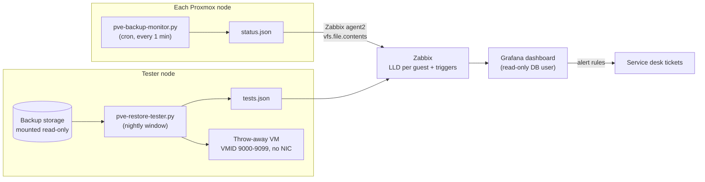

# Proxmox Backup Monitor & Automated Restore Tester

[](https://github.com/gabrielsilva-it/proxmox-backup-monitor/actions/workflows/tests.yml)

> A backup that was never restored is just a hope.

Two small Python tools (standard library only) that answer, every minute, two questions about a Proxmox VE environment:

1. **Is every VM/CT actually being backed up on time?** (`pve-backup-monitor.py`)
2. **Can those backups really be restored?** (`pve-restore-tester.py`)

Results are exposed to **Zabbix** (low-level discovery, one item set per guest) and visualised in **Grafana**, with alert rules that open tickets in a service desk.

Built and running in production at a manufacturing company with multiple sites and several Proxmox nodes. This repository is a generic, sanitised version: no company names, hosts, IPs or credentials.

---

## Screenshot

Grafana dashboard with demo data (fictitious hosts and VMs): overall state, problems right now, collection per host, backup jobs, and the backup and restore-test state of every VM.


## Architecture



## What it detects

`pve-backup-monitor.py` is **read-only**: it only queries `pvesh`/`qm` and reads `/var/log/vzdump`. Nothing is hard-coded: guests, backup jobs (`vmid`, `all`, `exclude`, `pool`) and backup files are discovered on every run.

For each guest it compares the newest backup with the interval implied by the job's own schedule (it parses Proxmox calendar events such as `sun 01:00`, `mon..fri 21:00` or `*-*-1`) and reads the result of the last `vzdump` run.

| State | Severity | Meaning |
|---|---|---|
| `ok` | 0 | Recent backup inside the expected interval |
| `isento` | 0 | Exempt: template, or tagged `sem-backup` |
| `novo_sem_job` | 1 | New VM (< 48 h) not yet covered by a job |
| `aguardando` | 1 | Covered by a job, first backup still pending |
| `falhou` | 2 | Last vzdump run failed (error message captured) |
| `stale` | 2 | Newest backup older than the job interval + grace |
| `sem_backup` | 2 | Covered by a job but no backup exists |
| `sem_job` | 2 | No backup job covers this guest |

The JSON never contains `null` values (Zabbix treats them as invalid), so missing ages and sizes become `-1` or `0`.

## Automated restore testing

`pve-restore-tester.py` runs on one node, mounts the backup storage **read-only**, and picks the most overdue guest first (never-tested guests come first). It works only inside a configurable night window.

- **Integrity:** reads the whole archive (zstd/lzop/gzip + `vma verify`, or `tar -t` for containers).
- **Restore:** restores into a temporary VM (VMID 9000-9099, name `rt-<vmid>`) **with no network card**, limited RAM, protection, hotplug and hookscripts removed. It boots the VM, checks that it really booted (uptime and disk reads), then destroys it.
- Big VMs are restored at most once a week; failed restores are retried the next night; very large disks get integrity checks only, to protect target storage.
- Which guests are tested is controlled by Proxmox **tags** (`testar` opts in, `sem-backup` opts out).
- **Backup-aware guard:** it never tests while a backup is running (an active `vzdump` task on the node, or a partial `.dat`/`.tmp` file still being written on the share), and it skips any test that would still be running when the next local backup job starts. It waits for that job to finish and resumes the same night. Job start times come from `pvesh get /cluster/backup` + `systemd-analyze calendar`. Tune it under `guard` in the config; `--sem-guarda` bypasses it for a manual run, and `--check` prints what the guard sees (active tasks, next job start times).

Restore is **disabled by default**. Turn it on in `/etc/pve-restore-tester.json` once integrity runs are clean.

## Repository layout

```
src/        pve-backup-monitor.py, pve-restore-tester.py
zabbix/     Zabbix 7.4 templates (export format)
grafana/    dashboard JSON, alert rules, script that creates a read-only datasource
tools/      dashboard generator (dashboard JSON is generated, not hand-edited)
tests/      unit tests with recorded real-world scenarios
```

## Quick start

On every Proxmox node (Python 3 is already there):

```bash
install -m 755 src/pve-backup-monitor.py /usr/local/bin/
pve-backup-monitor.py            # table on screen, changes nothing
pve-backup-monitor.py --install  # cron every minute -> /var/lib/pve-backup-monitor/status.json
```

On the node that will run restore tests:

```bash
install -m 755 src/pve-restore-tester.py /usr/local/bin/
pve-restore-tester.py --install  # folders, default config, cron
pve-restore-tester.py --check    # tools, mount, tags (tests nothing)
pve-restore-tester.py --plan     # what would be tested now
pve-restore-tester.py --run --only pve1/100 --level integrity   # manual test of one guest
```

Then import the templates from `zabbix/` and link them to the Proxmox hosts (Zabbix agent2 must be able to read `/var/lib/pve-backup-monitor/*.json`). For the dashboard, run `GRAFANA_AUTH='admin:<password>' grafana/setup-datasource.sh` on the Zabbix/Grafana host and import `grafana/dashboard_pve_backup.json`.

## Tests

```bash
python tests/test_pve_backup_monitor.py src/pve-backup-monitor.py
python tests/test_restore_tester.py   src/pve-restore-tester.py
pip install pyyaml
python tests/check_zbx_template.py        zabbix/zbx_template_pve_backup_monitor_7.4.yaml src/pve-backup-monitor.py
python tests/check_zbx_template_tester.py zabbix/zbx_template_pve_restore_tester_7.4.yaml
```

The unit tests replay real scenarios (mixed schedules, failed runs, interrupted logs, exempt tags, removed VMs, corrupted archives) with names anonymised.

## Tech

Python 3 (stdlib only) · Proxmox VE (`pvesh`, `qm`, `vzdump`) · Zabbix 7.4 (agent2, LLD) · Grafana · PostgreSQL · cron/flock

---

## Resumo em português

Duas ferramentas em Python para Proxmox VE:

- **Monitor de backup:** verifica a cada minuto se cada VM/CT tem backup em dia, conforme o agendamento do próprio job. Mostra o estado de cada guest (ok, falhou, atrasado, sem backup, sem job…) no Zabbix e no Grafana.
- **Testador de restore:** à noite, restaura os backups em VMs temporárias **sem rede**, confere se ligam e depois apaga. Assim, o backup fica comprovado, não só presumido. Uma trava evita testar durante um backup em andamento ou pouco antes do próximo job: o testador espera o backup passar e continua na mesma noite.

Os alertas abrem chamados automaticamente. Projeto usado em produção numa indústria com várias unidades; esta é uma versão genérica, sem dados da empresa.

## License

[MIT](LICENSE)
